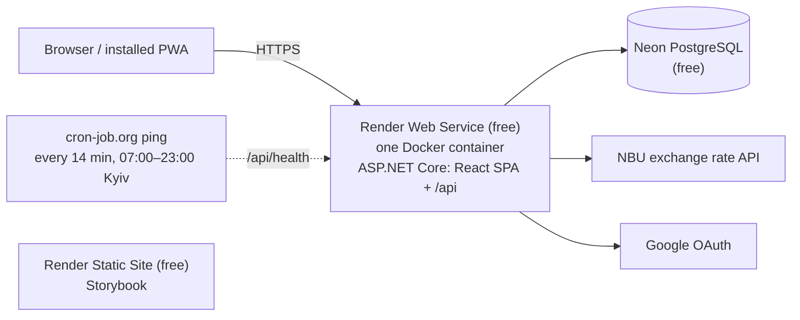
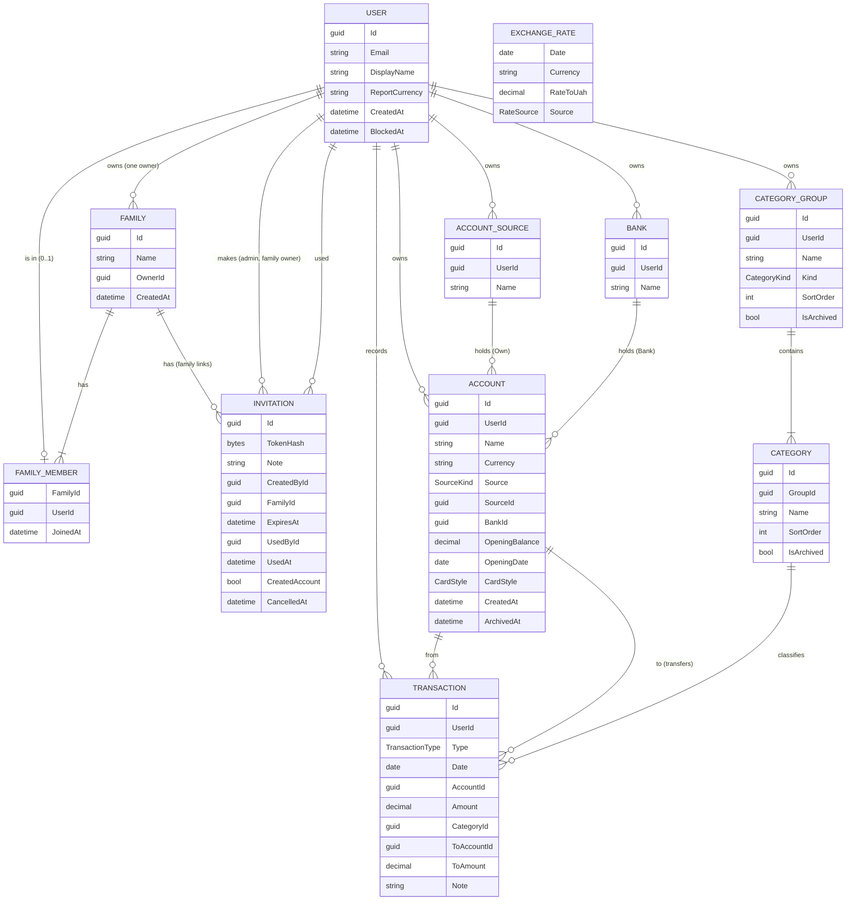
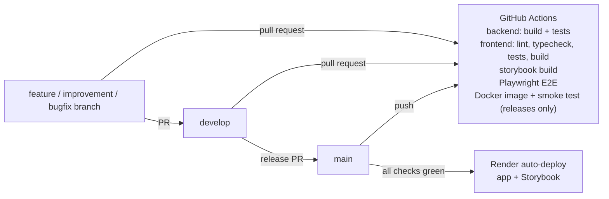

# Architecture

## Overview

The frontend is a **single-page application (SPA)**: React is built into static files (HTML, JS, CSS)
and everything runs in the browser. It talks to the backend REST API with JSON.

Frontend and backend are hosted **together as one service on Render**: one Docker container in which
ASP.NET Core serves the React build (static files) and the API under `/api`.



Why this shape (details in [ADR 0002](decisions/0002-hosting-render-neon.md)):

- **One origin, standard setup → least risk.** No proxying, no CORS, a plain first-party auth cookie, and
  Google sign-in works with the standard ASP.NET Core configuration.
- **Sleeping is handled:** the free service sleeps after 15 minutes without traffic. A free external ping keeps
  it awake during the day; at night the PWA opens instantly from its cache and shows "Waking up the server…"
  while the API starts (up to about a minute).
- Render's free PostgreSQL expires after 30 days, so the database is on **Neon** (free forever, 0.5 GB).
- Storybook is a separate free Render static site (static sites don't sleep and don't use instance hours).

## Repository layout

```
/
├─ backend/
│  ├─ PupBudgetPlanner.slnx
│  ├─ src/
│  │  ├─ PupBudgetPlanner.Domain/          entities, value objects, domain rules (no dependencies)
│  │  ├─ PupBudgetPlanner.Application/     use cases (services), DTOs, validation, interfaces
│  │  ├─ PupBudgetPlanner.Infrastructure/  EF Core + PostgreSQL, Identity stores, NBU client
│  │  └─ PupBudgetPlanner.Api/             controllers, auth setup, DI, OpenAPI, SPA hosting
│  └─ tests/
│     ├─ PupBudgetPlanner.Domain.Tests/
│     ├─ PupBudgetPlanner.Application.Tests/
│     └─ PupBudgetPlanner.Api.Tests/       (after MVP: integration tests with Testcontainers)
├─ frontend/
│  ├─ src/
│  │  ├─ app/          providers, router, layout, theme
│  │  ├─ features/     auth, accounts, categories, transactions, reports, family, settings
│  │  └─ shared/       api client (generated types), ui components, hooks, i18n, utils
│  ├─ .storybook/
│  └─ e2e/             Playwright tests
├─ docs/
│  └─ changes/         one folder per feature / improvement / bugfix (see docs/changes/README.md)
├─ Dockerfile          multi-stage: build React → build API → one runtime image
├─ render.yaml         Render Blueprint (infrastructure as code)
└─ .github/workflows/  CI
```

## Backend

- **ASP.NET Core (.NET 10, LTS)** with **controllers** (familiar, explicit, easy to review).
- **Layered ("clean") architecture**: `Domain` has no dependencies; `Application` contains the use cases
  and depends only on `Domain` and its own interfaces; `Infrastructure` implements those interfaces;
  `Api` wires everything together.
- **No MediatR / AutoMapper** (both went commercial; plain services and hand-written mapping are simpler to read).
- **EF Core + Npgsql (PostgreSQL)**, code-first migrations, snake_case table and column names
  ([ADR 0009](decisions/0009-database-conventions.md)). Migrations are applied on API start-up
  (single instance — acceptable for the MVP).
- **Validation:** FluentValidation. **Errors:** RFC 7807 `ProblemDetails`.
- **OpenAPI:** built-in `Microsoft.AspNetCore.OpenApi`; the frontend generates TypeScript types from it.
- **Hosting the SPA:** the React build is copied to `wwwroot`; ASP.NET Core serves it with static files and
  `MapFallbackToFile("index.html")` for client-side routes. Everything under `/api` is the API (unknown `/api`
  routes are 404s, not `index.html`). Hashed bundles in `/assets` are cached for a year, the rest is `no-cache`
  ([ADR 0010](decisions/0010-docker-image.md)).
- **Behind Render's proxy:** forwarded headers (`X-Forwarded-For`/`Proto`) are enabled so generated URLs
  (e.g. the Google callback) use `https`; Render passes the `Host` header through. HTTPS redirection runs only in
  Development (Render redirects in production); production sends HSTS.
- **Data Protection keys are stored in the database.** Render's disk is wiped on every restart (and the free
  service restarts after each sleep); with keys on disk, every user would be signed out each morning.
- **Report calculation** is a pure, in-memory component (`ReportBuilder`, Application): it gets what the database
  summed (incomes and expenses per day, type, currency and category; each account's movement per month) and the
  rates, and returns the report table. This keeps the most important logic fully unit-testable without a database.
  Data volume is small (thousands of rows per family per year) ([ADR 0027](decisions/0027-report-engine.md)).

### Data model (first draft)



- `Amount` is always positive; `Type` gives the direction.
- Money: `numeric(18,2)`; rates: `numeric(18,6)`. Amounts people enter are whole units, rounded half away from zero
  (`Money.Whole`); amounts worked out from rates are kept as they are and rounded when shown
  ([ADR 0018](decisions/0018-whole-amounts.md)).
- Categories: every account gets its own copy of the default set (`DefaultCategories`) in the transaction that
  creates it; group names are unique per person, category names per group
  ([ADR 0015](decisions/0015-default-categories-seeding.md)). Each person changes their own set (F-029): the rules
  live in `CategorySet` (names unique ignoring case, hidden ones counting; a category moves only within its kind;
  places among the shown ones, sort orders renumbered from 1, income groups first). A category with transactions is
  hidden (`IsArchived`), not deleted; a group goes only without shown categories, deleted when empty, hidden with its
  hidden ones otherwise; the last group of a kind stays. `GET /api/categories` sends the hidden ones too, marked, with
  each category's transaction count; the quick-add form leaves them out
  ([ADR 0028](decisions/0028-changing-categories.md)).
- Invitations (F-028): an invite link for one person, valid once for 7 days; only the token's SHA-256 is stored.
  Its status (waiting, used, expired, cancelled) comes from the dates. A blocked person keeps their data
  (`BlockedAt`) ([ADR 0016](decisions/0016-invite-only-sign-up.md)). A family's link (F-023) has a `FamilyId`: it
  joins its person to the family, whether it creates their account or they already have one; `CreatedAccount` tells
  the two apart ("Invited" on the People page).
- Families (F-023): a person is in one family at most (a unique index on `family_members.user_id`); the family has one
  owner (`OwnerId`), who renames it, invites (family links) and removes people. The rules live in the `Family`
  aggregate: an owner leaving others names the next owner, the last one to leave deletes the family (its waiting
  links cancelled first); deleting an account hands its family to whoever has been in it longest. Nothing of anyone's
  is deleted by joining, leaving or removing ([ADR 0029](decisions/0029-families.md)).
- Family views (F-024): the read endpoints of Transactions, Accounts and Reports take `who` (`me`, `family` or a
  member's id); `Family.SeenBy` decides whose money that is, and the services read a `MoneyScope` (the viewer and the
  people) instead of a user id. Writes still take the signed-in person only, so someone else's money is only to look
  at. Accounts and transactions carry their `OwnerId`; the family's categories of one group and name are merged on
  each read (`FamilyCategories`), amounts in the viewer's report currency ([ADR 0031](decisions/0031-family-views.md)).
- Accounts (F-014): the source is Cash, Bank or one of the person's own sources; a bank account names one of the
  person's banks. Own sources and banks are personal rows (a name unique per person) that stay while an account uses
  them. Balances are never stored: `BalanceSheet` adds each account's transactions to its opening balance and totals
  the currencies over the accounts in use (archived ones are left out)
  ([ADR 0017](decisions/0017-accounts-sources-banks.md)). No two accounts in use alike (I-020): the same name
  (ignoring case), currency, source and own source or bank is refused when adding, editing or restoring
  (`Account.CopyIn`), backed by a partial unique index ([ADR 0026](decisions/0026-no-copies-of-accounts.md)).
- Transactions (F-018): an expense or an income on one account, with a category of the matching kind, a whole amount
  above zero, a day never after today and an optional note. Balances come from the database's sums per account and
  type (`TransactionSum` → `BalanceSheet.MovementsOf`); an account with transactions can't be deleted or change its
  currency. The form's picks (last account, last category per account, most used) are worked out in memory from the
  latest 1 000 added (`TransactionSuggestions`) ([ADR 0022](decisions/0022-transactions-and-balances.md)).
- Transfers (F-019): one row with both accounts, no category: the From side (`AccountId`, `Amount`) and the To side
  (`ToAccountId`, `ToAmount`, what that account got; the amount itself in one currency, the bank's figure for an
  exchange). Balances count it on both sides; an account used on either side counts as used. A check constraint keeps
  the shape. The form suggests an exchange's second amount from `GET /api/rates?date=…`
  ([ADR 0023](decisions/0023-transfers-one-row.md)).
- The Transactions list (F-020): `GET /api/transactions` pages the rows the filters find (period, account, category,
  type) by offset, newest first; `GET /api/transactions/summary` gives what they come to (spent, received, each
  day's and each category's) in the report currency at the NBU rate of each day, or in one picked account's currency.
  The page keeps the filters in its address ([ADR 0024](decisions/0024-transactions-list-and-summary.md)).
- Reports (F-021): `GET /api/reports/year?year=…` and `GET /api/reports/month?month=yyyy-MM`, optional `currency`. One
  `Report` shape: the groups' and categories' months with Total and Avg, then Total income, Total expenses, NET, Other
  changes and the real month-end balance; months still to come are `null`; `firstMonth` is the person's first month
  with data, so the Reports page (F-022) steps back only as far as there is something
  ([ADR 0027](decisions/0027-report-engine.md)). The page keeps its period and currency in its address
  (`/reports?month=2026-10&currency=USD`), and a category's amount links to the Transactions page's address for it.
- Currencies are ISO 4217 codes (`char(3)`): the hryvnia and every currency the NBU publishes an official rate for,
  listed once in `Currencies.All` (Domain). The API sends the list with the accounts; the frontend only names them.

#### Enums

| Enum | Values | Used in | Meaning |
|------|--------|---------|---------|
| `TransactionType` | `Expense`, `Income`, `Transfer` (F-019) | `Transaction.Type` | Direction of the money: leaves an account, comes into an account, or (F-019) moves between two own accounts |
| `CategoryKind` | `Income`, `Expense` | `CategoryGroup.Kind` | Report section of the group; which categories the form offers for an expense or an income |
| `SourceKind` | `Cash`, `Bank`, `Own` | `Account.Source` | Where the money is: cash, one of the person's banks, or one of their own sources (F-014) |
| `CardStyle` | `Solid`, `Tinted`, `Envelope`, `Plain` | `Account.CardStyle` | How the account's card looks; a new account starts with its source's style (F-014) |
| `RateSource` | `Nbu` | `ExchangeRate.Source` | Where the rate came from; leaves room for other sources |
| `RatesStatus` | `Current`, `NotPublished`, `Unavailable`, `Missing` | API only (`AccountsTotal.Status`, `RatesOfDay.Status`) | Whether the rates are the asked day's, and if not, why (F-017) |
| `ReportMonthState` | `Passed`, `Current`, `Future` | API only (`ReportMonth.State`) | Where a report's month is against Kyiv's today; a month still to come has no numbers (F-021) |

**Storage:** enums are C# `enum` types in the Domain layer and are stored in PostgreSQL **as text**
(`"Expense"`, `"Solid"`) with EF Core `HasConversion<string>()`, in a `varchar` column with a maximum length.

- The data stays readable when you query the database directly.
- Reordering or adding enum values can never change the meaning of existing rows (with numbers, inserting
  a value in the middle would shift the meaning of everything after it).
- The API also sends and receives enums as strings (`JsonStringEnumConverter`), so the generated
  TypeScript types are string unions (`'Expense' | 'Income' | 'Transfer'`).

#### Consistency rules (validated in the Application layer; the database checks them too, F-019)

| `Type` | `CategoryId` | `ToAccountId` / `ToAmount` |
|--------|--------------|----------------------------|
| `Expense` | required, category of a group with `Kind = Expense` | empty |
| `Income` | required, category of a group with `Kind = Income` | empty |
| `Transfer` | empty | required; `ToAccountId` ≠ `AccountId`; if the currencies are equal, `ToAmount` = `Amount` |

### Exchange rates

- Source: NBU open API (`bank.gov.ua/NBUStatService/v1/statdirectory/exchange`), which has history. Rates are
  hryvnias for one unit.
- Rates are fetched **on demand** for a date that is missing and cached in the `exchange_rates` table: one NBU call
  brings the whole day, all currencies (F-017, [ADR 0019](decisions/0019-exchange-rate-cache.md)).
  (No background timer: the free API service sleeps, so timers are unreliable.)
- If the NBU hasn't published the day or can't be reached, the latest earlier kept rates are used and marked
  (`RatesStatus`: `NotPublished`, `Unavailable`; `Missing` when there are none); they are never stored under the
  later date. After a failed call the NBU is left alone for 5 minutes.
- "Today" is Kyiv's date. `Conversion` (Domain, pure) converts through the hryvnia, so any report currency works.
- Each person picks their report currency in Settings (F-016): the hryvnia or any other NBU currency, kept on the
  account (`users.report_currency`). Totals give the rates they used in hryvnias, as the NBU publishes them
  ([ADR 0020](decisions/0020-user-settings.md)).
- The NBU's address is configuration (`Nbu:BaseAddress`); the E2E run in CI points it at a stub.

## Authentication

- **ASP.NET Core Identity** with an HTTP-only, `Secure`, `SameSite=Lax` **cookie** (same origin as the SPA).
- **Google sign-in** through Identity external logins (`AddGoogle`): "Continue with Google" links to
  `/api/auth/google`, Google comes back to `/api/auth/google/callback`, and `/api/auth/google/complete` signs the
  person in. The first sign-in creates the account, or links to the account with the same email Google has
  verified. If that account's email was never confirmed, its password is removed and its other sessions end
  ([ADR 0014](decisions/0014-google-sign-in.md)).
- The SPA calls `/api/auth/*` endpoints (register, login, logout, me, Google). `me` also issues the
  antiforgery token; the app asks it again after signing in or out.
- Every endpoint needs a signed-in person unless it says `[AllowAnonymous]` (fallback policy).
- Protection against CSRF: `SameSite` cookie + antiforgery token (`XSRF-TOKEN` cookie → `X-XSRF-TOKEN` header) on
  every request that changes something.
- No account enumeration: one message for a wrong email or password, a neutral one for a taken email, rate
  limits per IP on sign-in and sign-up.
- Adding more providers later (Microsoft, Apple) is configuration only.
- Details: [ADR 0003](decisions/0003-auth-identity-google.md), [ADR 0012](decisions/0012-account-enumeration.md),
  [ADR 0013](decisions/0013-auth-api.md), [ADR 0014](decisions/0014-google-sign-in.md).

## Frontend

- **React + TypeScript + Vite**, on Node 24 LTS; TypeScript pinned to 5.9 ([ADR 0008](decisions/0008-frontend-toolchain.md)).
- **Mantine** — UI components, `@mantine/charts`, `@mantine/dates`, `@mantine/form` (+ zod schemas),
  `@mantine/notifications`. Icons: Tabler Icons.
- **TanStack Query** — fetching / caching / refreshing server data.
- **React Router** — pages.
- **openapi-typescript + openapi-fetch** — typed API client generated from the backend OpenAPI document.
- **react-i18next** — every text through translation keys (English now; Ukrainian later).
- **vite-plugin-pwa** — installable app (manifest + service worker).
- **Storybook** — component catalogue; published as a separate free Render static site.

## Testing

| Level | Tools | What | When |
|-------|-------|------|------|
| Backend unit | xUnit v3 on Microsoft.Testing.Platform ([ADR 0007](decisions/0007-test-runner-mtp.md)), NSubstitute, AwesomeAssertions | Domain rules, application services, ReportBuilder, validators | MVP |
| Frontend unit / component | Vitest, React Testing Library, MSW | Hooks, components, forms | MVP |
| UI / E2E | **Playwright** | Real user flows in a browser against the real API + PostgreSQL (in CI) | MVP |
| Visual | Storybook stories (+ Playwright screenshots later) | Components in all states | MVP |
| Integration | xUnit + `WebApplicationFactory` + Testcontainers (PostgreSQL) | API + database together | **After MVP** |

- Integration tests will run **only in CI** (GitHub Actions has Docker), so Docker is not needed locally.
- E2E in CI uses a PostgreSQL service container; locally they run against a Neon `dev` branch.

## CI/CD



- One workflow file: `.github/workflows/ci.yml`; it runs on pull requests (except docs-only ones: `docs/**`,
  `*.md`) and on the push to `main`, not on the push to `develop`, which would only repeat its PR's run (I-031,
  [ADR 0030](decisions/0030-ci-runs-once-per-change.md)).
  Four parallel jobs: Backend, Frontend (incl. Storybook build), E2E (Playwright), Docker image (builds the
  production image, starts it against PostgreSQL and smoke-tests the app and the API; only on a PR into `main` and
  the push to `main`).
- **Only `main` is deployed.** Render services are described in `render.yaml`, track `main`, and deploy
  **only after the GitHub checks pass**.
- Private repo → GitHub Actions has 2,000 free minutes/month. Running on every push used 90% of them in 12 days
  (November 2026); since I-031 each change is checked once, about half as many minutes.

## Environments and configuration

| Environment | Frontend | API | Database |
|-------------|----------|-----|----------|
| Local | `vite` dev server (proxy `/api` → API) | `dotnet run` | Neon `dev` branch |
| CI | built SPA (`vite preview`, proxy `/api` → API) | built API (`dotnet run --no-build`) | PostgreSQL service container |
| Production | served by the API container | Render web service | Neon `main` branch |

Secrets (connection string, Google client ID/secret) are stored in **Render environment variables**
and locally in **`dotnet user-secrets`** — never in the repository.

## Known risks

| Risk | Mitigation |
|------|-----------|
| Free service sleeps after 15 min idle; wake-up up to ~1 min | Keep-awake ping 07:00–23:00 Kyiv (~500 of 750 free hours/month); PWA cache + "waking up" indicator at night |
| Render changes its free tier or limits pinging | Upgrade to the Starter instance (~$7/month) — no code changes |
| Users signed out after restarts | Data Protection keys stored in PostgreSQL |
| Render free service: 512 MB RAM, shared CPU | Small .NET footprint; measured in F-009 |
| Neon free: 0.5 GB, 100 compute-hours/month | Far above our needs; `/api/health` does not touch the DB, so pings don't wake it |
