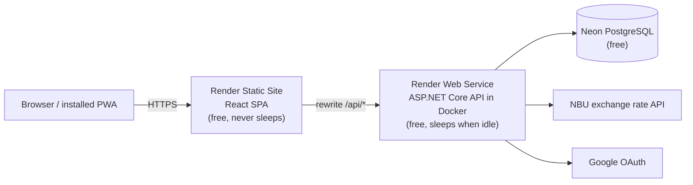
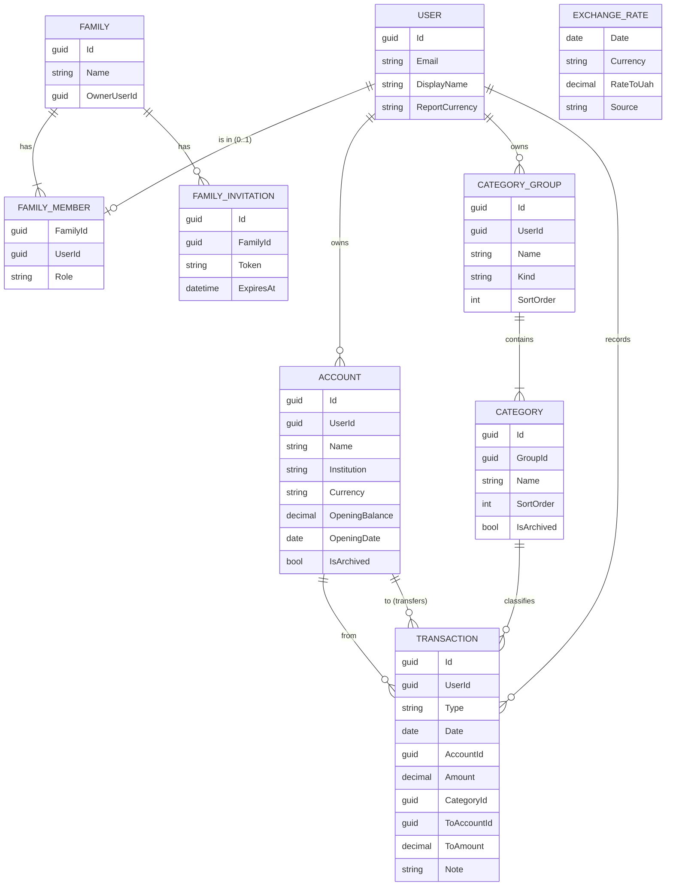
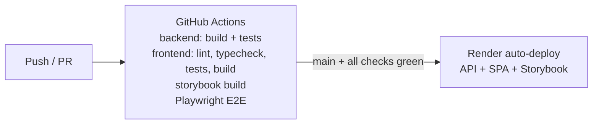

# Architecture

## Overview

The frontend is a **single-page application (SPA)**: React is built into static files (HTML, JS, CSS)
and everything runs in the browser. It talks to the backend REST API with JSON.

Frontend and backend are hosted **separately on Render**, but look like **one website** to the browser:



Why this shape (details in [ADR 0002](decisions/0002-hosting-render-neon.md)):

- The static site is served from a CDN and **never sleeps**, so the app opens instantly even when the
  API is asleep. The UI shows "Waking up the server…" while the first API call is in progress.
- The static site **rewrites `/api/*` to the API service**, so the browser sees a single origin:
  no CORS, and the auth cookie is a simple first-party cookie.
- Render's free PostgreSQL expires after 30 days, so the database is on **Neon** (free forever, 0.5 GB).

## Repository layout

```
/
├─ backend/
│  ├─ PupBudgetPlanner.slnx
│  ├─ src/
│  │  ├─ PupBudgetPlanner.Domain/          entities, value objects, domain rules (no dependencies)
│  │  ├─ PupBudgetPlanner.Application/     use cases (services), DTOs, validation, interfaces
│  │  ├─ PupBudgetPlanner.Infrastructure/  EF Core + PostgreSQL, Identity stores, NBU client
│  │  └─ PupBudgetPlanner.Api/             controllers, auth setup, DI, OpenAPI, Dockerfile
│  └─ tests/
│     ├─ PupBudgetPlanner.Domain.Tests/
│     ├─ PupBudgetPlanner.Application.Tests/
│     └─ PupBudgetPlanner.Api.Tests/       (after MVP: integration tests with Testcontainers)
├─ frontend/
│  ├─ src/
│  │  ├─ app/          providers, router, layout, theme
│  │  ├─ features/     auth, accounts, categories, transactions, reports, family, settings
│  │  └─ shared/       api client (generated types), ui components, hooks, i18n, utils
│  ├─ .storybook/
│  └─ e2e/             Playwright tests
├─ docs/
├─ render.yaml         Render Blueprint (infrastructure as code)
└─ .github/workflows/  CI
```

## Backend

- **ASP.NET Core (.NET 10, LTS)** with **controllers** (familiar, explicit, easy to review).
- **Layered ("clean") architecture**: `Domain` has no dependencies; `Application` contains the use cases
  and depends only on `Domain` and its own interfaces; `Infrastructure` implements those interfaces;
  `Api` wires everything together.
- **No MediatR / AutoMapper** (both went commercial; plain services and hand-written mapping are simpler to read).
- **EF Core + Npgsql (PostgreSQL)**, code-first migrations. Migrations are applied on API start-up
  (single instance — acceptable for the MVP).
- **Validation:** FluentValidation. **Errors:** RFC 7807 `ProblemDetails`.
- **OpenAPI:** built-in `Microsoft.AspNetCore.OpenApi`; the frontend generates TypeScript types from it.
- **Report calculation** is a pure, in-memory component (`ReportBuilder`): it gets transactions and rates
  and returns the report table. This keeps the most important logic fully unit-testable without a database.
  Data volume is small (thousands of rows per family per year).

### Data model (first draft)



- `Amount` is always positive; `Type` gives the direction.
- For a transfer, `CategoryId` is empty and `ToAccountId` / `ToAmount` are filled.
- Money: `numeric(18,2)`; rates: `numeric(18,6)`.

### Exchange rates

- Source: NBU open API (`bank.gov.ua/NBUStatService/v1/statdirectory/exchange`), which has history.
- Rates are fetched **on demand** for a date that is missing and cached in the `ExchangeRate` table.
  (No background timer: the free API service sleeps, so timers are unreliable.)
- If the NBU API is unavailable, the latest known earlier rate is used and the UI marks it.

## Authentication

- **ASP.NET Core Identity** with an HTTP-only, `Secure`, `SameSite=Lax` **cookie**.
- **Google sign-in** through Identity external logins (`AddGoogle`). A Google account and an
  email/password account with the same verified email are linked.
- The SPA calls `/api/auth/*` endpoints (register, login, logout, me, external login).
- Protection against CSRF: `SameSite` cookie + antiforgery token header for state-changing requests.
- Adding more providers later (Microsoft, Apple) is configuration only.
- Details: [ADR 0003](decisions/0003-auth-identity-google.md).

## Frontend

- **React + TypeScript + Vite**.
- **Mantine** — UI components, `@mantine/charts`, `@mantine/dates`, `@mantine/form` (+ zod schemas),
  `@mantine/notifications`. Icons: Tabler Icons.
- **TanStack Query** — fetching / caching / refreshing server data.
- **React Router** — pages.
- **openapi-typescript + openapi-fetch** — typed API client generated from the backend OpenAPI document.
- **react-i18next** — every text through translation keys (English now; Ukrainian later).
- **vite-plugin-pwa** — installable app (manifest + service worker).
- **Storybook** — component catalogue; published as a separate Render static site.

## Testing

| Level | Tools | What | When |
|-------|-------|------|------|
| Backend unit | xUnit v3, NSubstitute, AwesomeAssertions | Domain rules, application services, ReportBuilder, validators | MVP |
| Frontend unit / component | Vitest, React Testing Library, MSW | Hooks, components, forms | MVP |
| UI / E2E | **Playwright** | Real user flows in a browser against the real API + PostgreSQL (in CI) | MVP |
| Visual | Storybook stories (+ Playwright screenshots later) | Components in all states | MVP |
| Integration | xUnit + `WebApplicationFactory` + Testcontainers (PostgreSQL) | API + database together | **After MVP** |

- Integration tests will run **only in CI** (GitHub Actions has Docker), so Docker is not needed locally.
- E2E in CI uses a PostgreSQL service container; locally they run against a Neon `dev` branch.

## CI/CD



- One workflow file: `.github/workflows/ci.yml`.
- Render services are described in `render.yaml` and deploy automatically from `main`
  **only after the GitHub checks pass**.
- Private repo → GitHub Actions has 2,000 free minutes/month; enough for this project.

## Environments and configuration

| Environment | Frontend | API | Database |
|-------------|----------|-----|----------|
| Local | `vite` dev server (proxy `/api` → API) | `dotnet run` | Neon `dev` branch |
| CI | built SPA | built API | PostgreSQL service container |
| Production | Render static site | Render web service | Neon `main` branch |

Secrets (connection string, Google client ID/secret) are stored in **Render environment variables**
and locally in **`dotnet user-secrets`** — never in the repository.

## Known risks

| Risk | Mitigation |
|------|-----------|
| Free API sleeps after 15 min idle; wake-up up to ~1 min | Instant SPA from static site + "waking up" indicator; optional keep-awake ping (Q-002) |
| Google OAuth callback / cookies through the static-site rewrite | Verify in spike T-007; fallback: serve SPA from the API (one service) |
| Render free API: 512 MB RAM, shared CPU | Small .NET footprint; measure in T-007 |
| Neon free: 0.5 GB, 100 compute-hours/month | Far above our needs; `/api/health` does not touch the DB so pings don't wake it |
