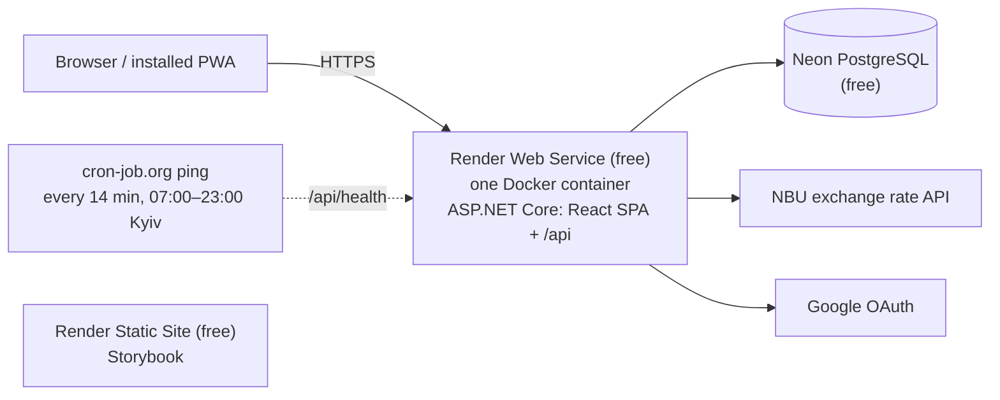
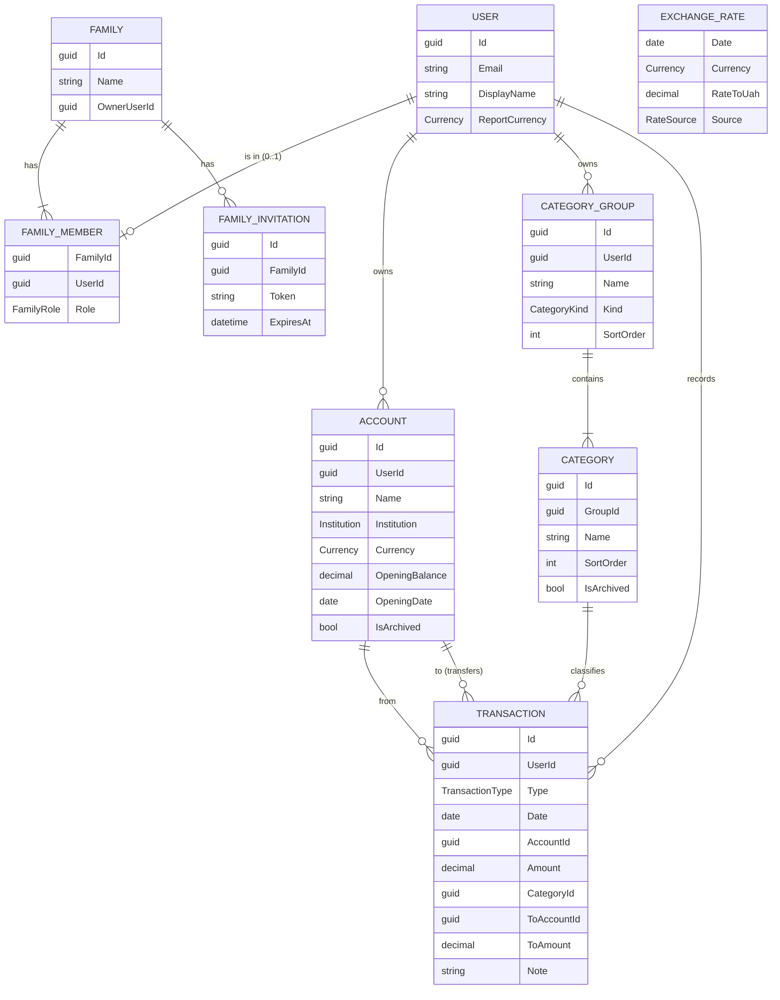
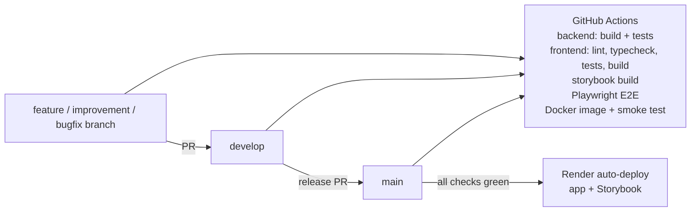

# Architecture

## Overview

The frontend is a **single-page application (SPA)**: React is built into static files (HTML, JS, CSS)
and everything runs in the browser. It talks to the backend REST API with JSON.

Frontend and backend are hosted **together as one service on Render**: one Docker container in which
ASP.NET Core serves the React build (static files) and the API under `/api`.



Why this shape (details in [ADR 0002](decisions/0002-hosting-render-neon.md)):

- **One origin, standard setup → least risk.** No proxying, no CORS, a plain first-party auth cookie, and
  Google sign-in works with the standard ASP.NET Core configuration.
- **Sleeping is handled:** the free service sleeps after 15 minutes without traffic. A free external ping keeps
  it awake during the day; at night the PWA opens instantly from its cache and shows "Waking up the server…"
  while the API starts (up to about a minute).
- Render's free PostgreSQL expires after 30 days, so the database is on **Neon** (free forever, 0.5 GB).
- Storybook is a separate free Render static site (static sites don't sleep and don't use instance hours).

## Repository layout

```
/
├─ backend/
│  ├─ PupBudgetPlanner.slnx
│  ├─ src/
│  │  ├─ PupBudgetPlanner.Domain/          entities, value objects, domain rules (no dependencies)
│  │  ├─ PupBudgetPlanner.Application/     use cases (services), DTOs, validation, interfaces
│  │  ├─ PupBudgetPlanner.Infrastructure/  EF Core + PostgreSQL, Identity stores, NBU client
│  │  └─ PupBudgetPlanner.Api/             controllers, auth setup, DI, OpenAPI, SPA hosting
│  └─ tests/
│     ├─ PupBudgetPlanner.Domain.Tests/
│     ├─ PupBudgetPlanner.Application.Tests/
│     └─ PupBudgetPlanner.Api.Tests/       (after MVP: integration tests with Testcontainers)
├─ frontend/
│  ├─ src/
│  │  ├─ app/          providers, router, layout, theme
│  │  ├─ features/     auth, accounts, categories, transactions, reports, family, settings
│  │  └─ shared/       api client (generated types), ui components, hooks, i18n, utils
│  ├─ .storybook/
│  └─ e2e/             Playwright tests
├─ docs/
│  └─ changes/         one folder per feature / improvement / bugfix (see docs/changes/README.md)
├─ Dockerfile          multi-stage: build React → build API → one runtime image
├─ render.yaml         Render Blueprint (infrastructure as code)
└─ .github/workflows/  CI
```

## Backend

- **ASP.NET Core (.NET 10, LTS)** with **controllers** (familiar, explicit, easy to review).
- **Layered ("clean") architecture**: `Domain` has no dependencies; `Application` contains the use cases
  and depends only on `Domain` and its own interfaces; `Infrastructure` implements those interfaces;
  `Api` wires everything together.
- **No MediatR / AutoMapper** (both went commercial; plain services and hand-written mapping are simpler to read).
- **EF Core + Npgsql (PostgreSQL)**, code-first migrations, snake_case table and column names
  ([ADR 0009](decisions/0009-database-conventions.md)). Migrations are applied on API start-up
  (single instance — acceptable for the MVP).
- **Validation:** FluentValidation. **Errors:** RFC 7807 `ProblemDetails`.
- **OpenAPI:** built-in `Microsoft.AspNetCore.OpenApi`; the frontend generates TypeScript types from it.
- **Hosting the SPA:** the React build is copied to `wwwroot`; ASP.NET Core serves it with static files and
  `MapFallbackToFile("index.html")` for client-side routes. Everything under `/api` is the API (unknown `/api`
  routes are 404s, not `index.html`). Hashed bundles in `/assets` are cached for a year, the rest is `no-cache`
  ([ADR 0010](decisions/0010-docker-image.md)).
- **Behind Render's proxy:** forwarded headers (`X-Forwarded-For`/`Proto`) are enabled so generated URLs
  (e.g. the Google callback) use `https`; Render passes the `Host` header through. HTTPS redirection runs only in
  Development (Render redirects in production); production sends HSTS.
- **Data Protection keys are stored in the database.** Render's disk is wiped on every restart (and the free
  service restarts after each sleep); with keys on disk, every user would be signed out each morning.
- **Report calculation** is a pure, in-memory component (`ReportBuilder`): it gets transactions and rates
  and returns the report table. This keeps the most important logic fully unit-testable without a database.
  Data volume is small (thousands of rows per family per year).

### Data model (first draft)



- `Amount` is always positive; `Type` gives the direction.
- Money: `numeric(18,2)`; rates: `numeric(18,6)`.

#### Enums

| Enum | Values | Used in | Meaning |
|------|--------|---------|---------|
| `TransactionType` | `Expense`, `Income`, `Transfer` | `Transaction.Type` | Direction of the money: leaves an account, comes into an account, or moves between two own accounts |
| `CategoryKind` | `Income`, `Expense` | `CategoryGroup.Kind` | Report section of the group; which categories the form offers for an expense or an income |
| `Currency` | `UAH`, `USD`, `EUR` (ISO 4217 codes) | `Account.Currency`, `User.ReportCurrency`, `ExchangeRate.Currency` | More currencies can be added later as new values |
| `Institution` | `Monobank`, `PrivatBank`, `Cash`, `Other` | `Account.Institution` | Where the account is held (icon and grouping in the UI) |
| `FamilyRole` | `Owner`, `Member` | `FamilyMember.Role` | The owner can invite and remove members |
| `RateSource` | `Nbu` | `ExchangeRate.Source` | Where the rate came from; leaves room for other sources |

**Storage:** enums are C# `enum` types in the Domain layer and are stored in PostgreSQL **as text**
(`"Expense"`, `"UAH"`) with EF Core `HasConversion<string>()`, in a `varchar` column with a maximum length.

- The data stays readable when you query the database directly.
- Reordering or adding enum values can never change the meaning of existing rows (with numbers, inserting
  a value in the middle would shift the meaning of everything after it).
- The API also sends and receives enums as strings (`JsonStringEnumConverter`), so the generated
  TypeScript types are string unions (`'Expense' | 'Income' | 'Transfer'`).

#### Consistency rules (validated in the Application layer)

| `Type` | `CategoryId` | `ToAccountId` / `ToAmount` |
|--------|--------------|----------------------------|
| `Expense` | required, category of a group with `Kind = Expense` | empty |
| `Income` | required, category of a group with `Kind = Income` | empty |
| `Transfer` | empty | required; `ToAccountId` ≠ `AccountId`; if the currencies are equal, `ToAmount` = `Amount` |

### Exchange rates

- Source: NBU open API (`bank.gov.ua/NBUStatService/v1/statdirectory/exchange`), which has history.
- Rates are fetched **on demand** for a date that is missing and cached in the `ExchangeRate` table.
  (No background timer: the free API service sleeps, so timers are unreliable.)
- If the NBU API is unavailable, the latest known earlier rate is used and the UI marks it.

## Authentication

- **ASP.NET Core Identity** with an HTTP-only, `Secure`, `SameSite=Lax` **cookie** (same origin as the SPA).
- **Google sign-in** through Identity external logins (`AddGoogle`): "Continue with Google" links to
  `/api/auth/google`, Google comes back to `/api/auth/google/callback`, and `/api/auth/google/complete` signs the
  person in. The first sign-in creates the account, or links to the account with the same email Google has
  verified. If that account's email was never confirmed, its password is removed and its other sessions end
  ([ADR 0014](decisions/0014-google-sign-in.md)).
- The SPA calls `/api/auth/*` endpoints (register, login, logout, me, Google). `me` also issues the
  antiforgery token; the app asks it again after signing in or out.
- Every endpoint needs a signed-in person unless it says `[AllowAnonymous]` (fallback policy).
- Protection against CSRF: `SameSite` cookie + antiforgery token (`XSRF-TOKEN` cookie → `X-XSRF-TOKEN` header) on
  every request that changes something.
- No account enumeration: one message for a wrong email or password, a neutral one for a taken email, rate
  limits per IP on sign-in and sign-up.
- Adding more providers later (Microsoft, Apple) is configuration only.
- Details: [ADR 0003](decisions/0003-auth-identity-google.md), [ADR 0012](decisions/0012-account-enumeration.md),
  [ADR 0013](decisions/0013-auth-api.md), [ADR 0014](decisions/0014-google-sign-in.md).

## Frontend

- **React + TypeScript + Vite**, on Node 24 LTS; TypeScript pinned to 5.9 ([ADR 0008](decisions/0008-frontend-toolchain.md)).
- **Mantine** — UI components, `@mantine/charts`, `@mantine/dates`, `@mantine/form` (+ zod schemas),
  `@mantine/notifications`. Icons: Tabler Icons.
- **TanStack Query** — fetching / caching / refreshing server data.
- **React Router** — pages.
- **openapi-typescript + openapi-fetch** — typed API client generated from the backend OpenAPI document.
- **react-i18next** — every text through translation keys (English now; Ukrainian later).
- **vite-plugin-pwa** — installable app (manifest + service worker).
- **Storybook** — component catalogue; published as a separate free Render static site.

## Testing

| Level | Tools | What | When |
|-------|-------|------|------|
| Backend unit | xUnit v3 on Microsoft.Testing.Platform ([ADR 0007](decisions/0007-test-runner-mtp.md)), NSubstitute, AwesomeAssertions | Domain rules, application services, ReportBuilder, validators | MVP |
| Frontend unit / component | Vitest, React Testing Library, MSW | Hooks, components, forms | MVP |
| UI / E2E | **Playwright** | Real user flows in a browser against the real API + PostgreSQL (in CI) | MVP |
| Visual | Storybook stories (+ Playwright screenshots later) | Components in all states | MVP |
| Integration | xUnit + `WebApplicationFactory` + Testcontainers (PostgreSQL) | API + database together | **After MVP** |

- Integration tests will run **only in CI** (GitHub Actions has Docker), so Docker is not needed locally.
- E2E in CI uses a PostgreSQL service container; locally they run against a Neon `dev` branch.

## CI/CD



- One workflow file: `.github/workflows/ci.yml`; it runs on pull requests and on pushes to `develop` and `main`.
  Four parallel jobs: Backend, Frontend (incl. Storybook build), E2E (Playwright), Docker image (builds the
  production image, starts it against PostgreSQL and smoke-tests the app and the API).
- **Only `main` is deployed.** Render services are described in `render.yaml`, track `main`, and deploy
  **only after the GitHub checks pass**.
- Private repo → GitHub Actions has 2,000 free minutes/month; enough for this project.

## Environments and configuration

| Environment | Frontend | API | Database |
|-------------|----------|-----|----------|
| Local | `vite` dev server (proxy `/api` → API) | `dotnet run` | Neon `dev` branch |
| CI | built SPA (`vite preview`, proxy `/api` → API) | built API (`dotnet run --no-build`) | PostgreSQL service container |
| Production | served by the API container | Render web service | Neon `main` branch |

Secrets (connection string, Google client ID/secret) are stored in **Render environment variables**
and locally in **`dotnet user-secrets`** — never in the repository.

## Known risks

| Risk | Mitigation |
|------|-----------|
| Free service sleeps after 15 min idle; wake-up up to ~1 min | Keep-awake ping 07:00–23:00 Kyiv (~500 of 750 free hours/month); PWA cache + "waking up" indicator at night |
| Render changes its free tier or limits pinging | Upgrade to the Starter instance (~$7/month) — no code changes |
| Users signed out after restarts | Data Protection keys stored in PostgreSQL |
| Render free service: 512 MB RAM, shared CPU | Small .NET footprint; measured in F-009 |
| Neon free: 0.5 GB, 100 compute-hours/month | Far above our needs; `/api/health` does not touch the DB, so pings don't wake it |
